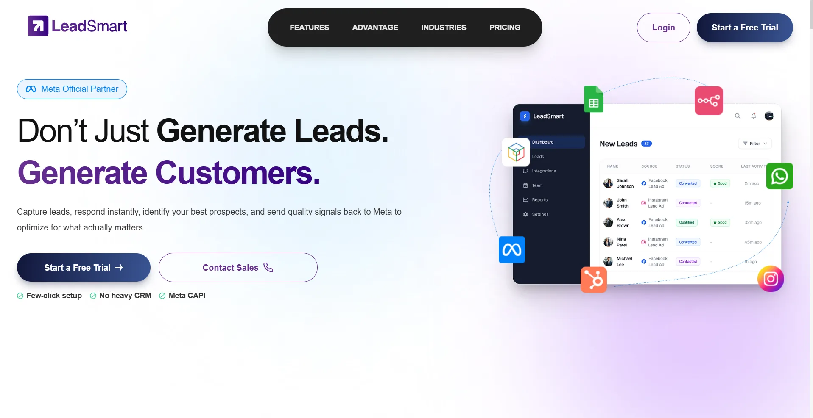
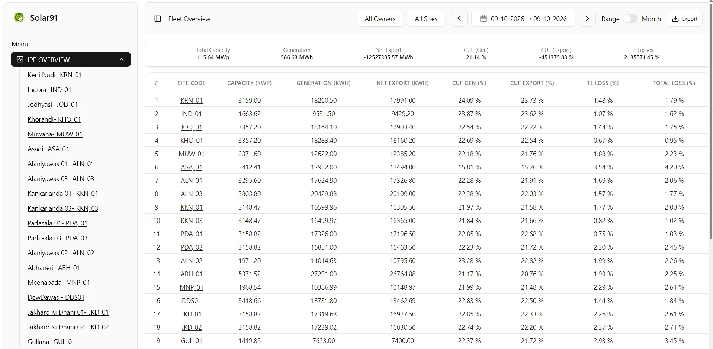
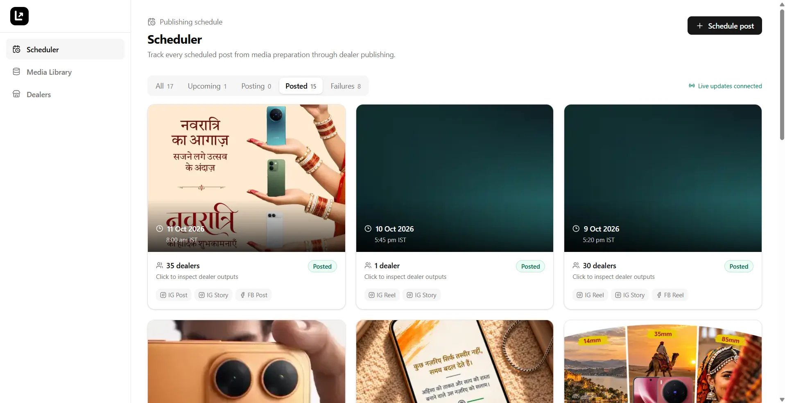

  

<h1 align="center">Shivam Sharma</h1>

  Backend Engineer &amp; AI Engineer · India   Building production LLM automation, conversational lead intelligence, distributed Node.js systems, and data-intensive backend services.

  <!-- <a href="https://atishaykasliwal.com">Portfolio</a> · -->
  <a href="https://www.linkedin.com/in/main-shivam-sharma">LinkedIn</a> ·
  <a href="mailto:main.shivamsharma@gmail.com">Email</a> ·
  <!-- <a href="https://atishaykasliwal.com/Atishay-Kasliwal-Resume.pdf">Résumé</a> -->

---

I build backend systems and AI products that turn messy operational data into reliable action. My work spans LLM-powered lead intelligence, conversational qualification and conversion workflows, multi-provider solar telemetry and analytics, and distributed Node.js services with queues, caching, APIs, and resilient integrations. I care about measurable outcomes, clear domain logic, and software that remains observable and operable after launch.

## Off the Clock

Part gamer, part chess nerd, part homelab enthusiast; I love getting lost in virtual worlds, overthinking my next move, and tinkering with things just to see what happens. I’m naturally curious, a little competitive, and always chasing that “wait, I think I’ve figured it out” moment.

## Selected work

<table>
  <tr>
    <td width="50%" valign="top">
      
      <h3><a href="https://leadsmart.pro">LeadSmart</a></h3>
      
LeadSmart is a production-ready lead management platform that streamlines Meta Lead Ads capture, data access, and lead routing. Built around scalable backend architecture, third-party integrations, asynchronous processing, and secure data governance.

      
<code>Node.js</code> <code>Express</code> <code>MySQL</code> <code>Redis</code> <code>BullMQ</code> <code>Meta APIs</code>

    </td>
    <td width="50%" valign="top">
      
      <h3>SolarSmart</h3>
      
Backend-first solar operations platform for managing renewable-energy sites, ingesting inverter and meter telemetry from multiple external providers, calculating generation and billing metrics, automating daily operational reports, and exposing validated analytics to AI clients through the Model Context Protocol (MCP).

      
<code>Node.js</code> <code>Express</code> <code>MySQL</code> <code>MongoDB</code> <code>Redis</code> <code>BullMQ</code> <code>MCP</code>

    </td>
  </tr>
  <tr>
    <td width="50%" valign="top">
      </a>
      <h3>SocialSmart</h3>
      
Social Smart is a Node.js backend platform for managing dealer-specific social media content, transforming branded image/video assets, scheduling multi-destination publishing, and reliably delivering posts to Meta platforms through an asynchronous worker system.

      
<code>Node.js</code> <code>Express</code> <code>MySQL</code> <code>Redis</code> <code>BullMQ</code> <code>Sharp</code> <code>FFmpeg</code> <code>Meta Graph API</code>

  </tr>
</table>

## Work

- **AI Engineer · nDimension Studios** — independently built and shipped LeadSmart, an AI lead-intelligence SaaS for ingestion, enrichment, qualification, scoring, CRM sync, and conversion automation; developed conversational classifiers and AI-assisted SEO workflows.
- **AI Engineer · nDimension Studios** — engineered Node.js services supporting 1,000 devices polling simultaneously, reduced critical dashboard latency from 2–3 seconds to below one second, and built BullMQ pipelines with retries, prioritization, and fault isolation across Meta, Google, WhatsApp, and CRM APIs.
- **Full Stack Intern · nDimension Studios** — built backend components for Node.js data pipelines, external API integrations, and business-process automation.

## Toolkit
| | |
| --- | --- |
| **AI & LLM** | LLM APIs, prompt engineering, conversational AI, intent classification, information extraction, AI workflow orchestration, AI-assisted SEO, MCP tooling |
| **Backend** | Node.js, JavaScript, Express.js, REST APIs, webhooks, unit testing |
| **Data & distributed systems** | MySQL, MongoDB, Redis, BullMQ, asynchronous processing, caching, fault isolation |
| **Integrations & infrastructure** | Meta, Google, WhatsApp, CRM APIs, Docker, AWS S3-compatible storage, CI/CD |

## What I optimize for

- **Measured product impact.** Lead response time, dashboard latency, throughput, and workflow completion should improve in observable ways.
- **Reliable automation.** Queues, retries, prioritization, idempotency, fault isolation, and explicit failure states keep third-party workflows dependable.
- **AI grounded in domain logic.** Models should produce useful actions through validated inputs, structured outputs, controlled access, and deterministic business rules.
- **Operability after launch.** Logging, health checks, metrics, clear errors, safe deployments, and maintainable service boundaries are part of the product.
- **Simple interfaces over complex systems.** Good APIs and user-facing workflows should make data, decisions, and system state understandable.

  Open to Backend and AI Engineering roles in India & Remote. 
  <a href="mailto:main.shivamsharma@gmail.com">main.shivamsharma@gmail.com</a>

